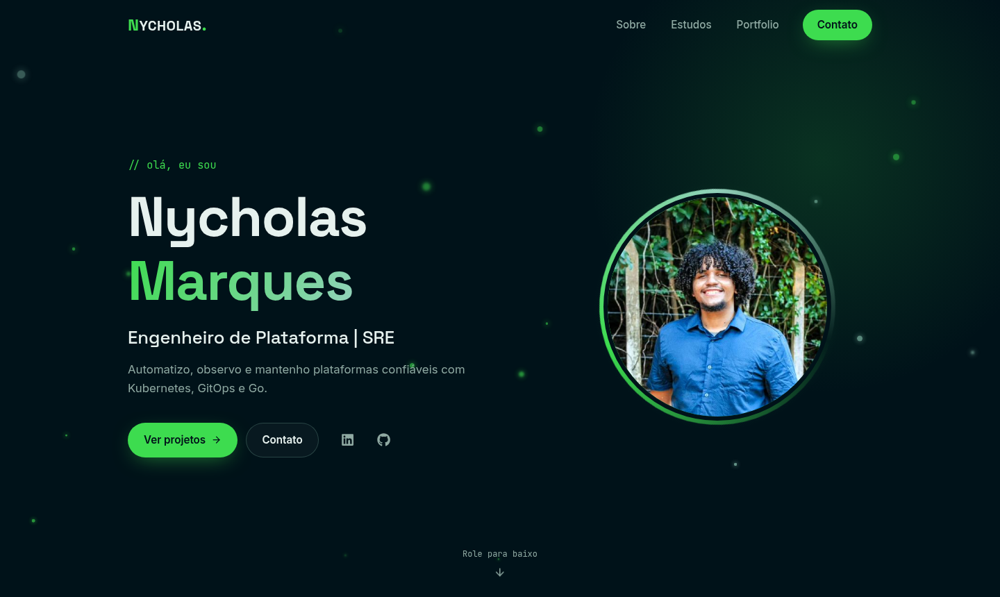

<h1 align="center">Nycholas Marques · Portfolio</h1>

<p align="center">
  Meu portfolio pessoal: um pouco da minha trajetória, do que estudo e dos projetos que construo. 🧑‍💻💚
</p>

<p align="center">
  <a href="https://portfolio-nycholas.vercel.app"><b>Ver online</b></a> ·
  <a href="https://www.linkedin.com/in/nycholas-marques-680411245/">LinkedIn</a> ·
  <a href="https://www.youtube.com/@DevNych">YouTube</a>
</p>

<p align="center">
  
</p>

## Sobre

Sou Engenheiro de Plataforma / SRE e trabalho com automação, confiabilidade, GitOps e observabilidade. Este site reúne:

- **Sobre mim**: quem sou e as tecnologias que uso no dia a dia
- **Estudos e experiências**: uma timeline da minha trajetória, de antes do código até hoje
- **Portfolio**: projetos como o [Roadkit](https://nycholasmarques.github.io/roadkit/) e o Anime Database
- **Contato**: um convite para conversar

## Tecnologias

- [React 18](https://react.dev) com [Vite](https://vitejs.dev)
- [Sass](https://sass-lang.com) para os estilos
- [GSAP](https://gsap.com) e IntersectionObserver para as animações de scroll
- [React Icons](https://react-icons.github.io/react-icons/)
- Deploy na [Vercel](https://vercel.com)

## Rodando localmente

Requer **Node.js 24**.

```bash
git clone https://github.com/nycholasmarques/portfolio-nycholas.git
cd portfolio-nycholas
npm install
npm run dev
```

O site abre em `http://localhost:5173`.

| Comando | O que faz |
| --- | --- |
| `npm run dev` | Servidor de desenvolvimento com hot reload |
| `npm run build` | Gera a versão de produção em `dist/` |
| `npm run preview` | Serve o build de produção localmente |
| `npm run lint` | Roda o ESLint |

## Atualizando o conteúdo

O conteúdo fica em listas simples dentro dos componentes, então atualizar é só editar um array:

| O quê | Onde |
| --- | --- |
| Tecnologias do "Sobre mim" | `stacks` em [`src/components/About.jsx`](src/components/About.jsx) |
| Marcos da timeline | `timeline` em [`src/components/Learning.jsx`](src/components/Learning.jsx) (os lados alternam sozinhos) |
| Projetos do portfolio | `projects` em [`src/components/Works.jsx`](src/components/Works.jsx) |
| Cargo e chamada do topo | Hero em [`src/App.jsx`](src/App.jsx) |

## Estrutura

```
src/
├── components/   # seções do site (Navbar, About, Learning, Works...)
├── hooks/        # useReveal: animação de entrada ao rolar
├── styles/       # Sass: variáveis, estilos globais e um arquivo por seção
└── img/          # imagens e favicon
```

---

<p align="center">
  Desenvolvido por <a href="https://github.com/nycholasmarques">Nycholas Marques</a>
</p>
